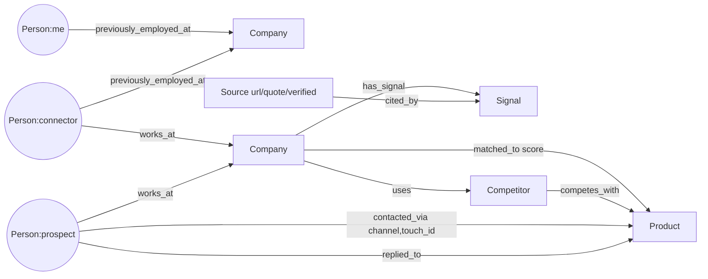

# Warmpath — System Design & Architecture

The spec's required System Design document, written from the code as it runs on 30 Oct 2026. The original plan is in
[DESIGN.md](DESIGN.md); where the two differ, this file is right (e.g. the graph store is Kùzu embedded, not Neo4j).

Repo layout: `web/` (Next.js 15, App Router, 5 screens, `src/lib/{types,api,seed}.ts`), `api/app/` (FastAPI, one module per
concern), `api/band_agents/` (Band room), `api/rl/` (bandit sim + GRPO), `.github/workflows/snyk.yml`, `deploy.sh`.

## 1. Query logic: from intake to a cited lead

### 1.1 Intake → ICP (`icp.py`)

1. `POST /intake` with `Intake{product_name, product_url, description, features, constraints, reference_customers,
   pricing_model, acv_usd, lost_deal, past_employers}`.
2. `llm.json_call("icp", ICP_SYSTEM, intake)` asks Claude for `{icp, expansions[3]}` where **every field is
   `Scored{value, confidence}`**. Provider chain in `llm.py`: Anthropic SDK → `claude -p … --output-format json --tools ""`
   (subscription) → deterministic `fallback_icp`. The first balanced JSON object in the reply is parsed; invalid JSON falls back.
3. `attach_sources()` builds one search query per ICP field (3 industries, size band, 3 personas, 4 triggers) plus the 3
   segments' `search_query`, capped at `MAX_SEARCHES=20`, run on a 6-thread pool. For each hit the best sentence is chosen
   (`_best_quote`, keyword-scored) and **validated against the live page**. Results are cached per query in
   `data/cache/icp_<sha1>.json` so re-runs cost zero searches.
4. `_adjust()` makes **confidence follow the evidence**: a verified source keeps it (≤0.95); unverified-only trims it
   (×0.85, ≤0.75); none caps it (×0.7, ≤0.55).
5. `past_employers` become `(me)-[:previously_employed_at]->(Company)` edges (`seed.set_me_history`), seeded connectors are
   re-pointed to those employers, every company is rescored and the first lead's drafts are rebuilt so the warm path in the
   email matches the graph.

### 1.2 Discovery (`discovery.py`)

`POST /discover` → `discovery.run()`:

1. **Queries** (`_queries`): three ATS-targeted job-post searches (`include_domains` = Ashby, Greenhouse, Lever, YC,
   Workable), two news searches (`topic=news`, `time_range=month`, TechCrunch/BusinessWire/…), plus one per **accepted or
   adjusted expansion segment**. Aggregators (LinkedIn, Indeed, Glassdoor, …) are excluded at the search layer.
   Run in parallel (5 threads), de-duplicated by URL, capped at 30 candidate pages (each kept claim costs a fetch).
2. **Search provider chain** (`search`): Tavily with key → Tavily keyless → last good cached result for that exact query
   (`data/search_cache.json`, still re-validated) → Serper → `[]`.
3. **Claim extraction**: Claude (`EXTRACT_SYSTEM`) turns results into
   `{company, domain, industry, naics, headcount, hq, signal_type, summary, quote, date, buyer_name, buyer_title, fit_reason}`.
   Rules in the prompt: the `quote` must be copied character-for-character from the result; `buyer_name` only if a real person
   is named; skip aggregators, listicles, the seller, its competitors, and companies over ~2000 staff.
   No-LLM fallback (`fb`): company from the ATS URL slug or a "X raises/launches …" headline, industry "Unclassified (no LLM)".
4. **Validation** (`validator.validate`, 8 threads): fetch the URL, normalise text (NFKC, lower-case, punctuation stripped),
   check the longest quote fragment or any 8-word window of it is present. If the direct fetch fails or is JS-rendered,
   Tavily Extract is the second opinion. **Unverified → appended to `state.dropped_claims`, never stored as a company.**
   A named buyer is kept only if `validator.page_contains(url, name)`; otherwise the lead is a role ("Head of Platform @ X").
5. **Upsert**: company + `Signal` + `Source` into state and Kùzu; a `Lead` per new person (variants alternate A/B).
6. `graph.hiring_signals(since=today−30d)` runs the hiring Cypher (§2.3) and the result is shown in the thinking feed.
7. `rescore_all()` and the summary `{added, total, tiers, dropped, hiring, companies}` are returned.

If live discovery adds nothing (or search is off), `seed.replay_validation()` re-emits the seed's validation steps so the
seeded accounts remain, clearly labelled `verified:false` / "sample".

### 1.3 Scoring (`discovery.score`)

`score = fit (0–60) + intent (0–40)`; tier **A ≥ 75, B ≥ 50, else C**.

| Fit component | Points |
|---|---|
| NAICS matches an ICP industry / industry name overlaps | 22 / 12 |
| Headcount inside the ICP band / within 3× the max (unknown = 0) | 16 / 6 |
| A buyer title overlaps an ICP persona | 10 |
| Page-verified citations (4 each, max 12) | ≤12 |
| ICP terms found in the **verified** quotes and summaries (3 each, max 16) | ≤16 |

Intent = `34 × signal_strength × recency` (strength: job_post 1.0, funding 0.9, exec_hire 0.8, churn_risk 0.8, tech_change 0.7,
launch 0.65; recency decays linearly to 0 over 60 days) + 2 per extra signal (max 6). Fit is read from the evidence, not
assumed from firmographics: a company with no verified source cannot score on citations or evidence terms.

### 1.4 Best signal (`state.best_signal`)

Outreach leads with exactly one signal: verified first, then by type rank (job_post > funding > exec_hire > launch =
tech_change > churn_risk), then newest. A signal whose source was dropped by the validator is never chosen. With no signal
at all, `POST /leads/{id}/draft` returns **422** ("refusing to write outreach without a 'why now'").

## 2. Graph ontology (Kùzu embedded)

`graph.py` opens `api/data/graph.kuzu` on boot (`fresh=True` wipes it) and rebuilds it from in-memory state via the seed
loader; Neo4j would sit behind the same functions. Writes are internal and unmetered; **user-visible reads go through
`graph.query()`, which emits a `ThinkingStep{kind:"graph", cypher}` and meters `graph_query`.**

### 2.1 Schema (exact DDL from `graph.SCHEMA`)

```cypher
CREATE NODE TABLE IF NOT EXISTS Company(id STRING, name STRING, domain STRING, industry STRING, score INT64, tier STRING, PRIMARY KEY(id))
CREATE NODE TABLE IF NOT EXISTS Person(id STRING, name STRING, title STRING, kind STRING, PRIMARY KEY(id))
CREATE NODE TABLE IF NOT EXISTS Product(id STRING, name STRING, url STRING, PRIMARY KEY(id))
CREATE NODE TABLE IF NOT EXISTS Competitor(id STRING, name STRING, PRIMARY KEY(id))
CREATE NODE TABLE IF NOT EXISTS Signal(id STRING, type STRING, summary STRING, date STRING, PRIMARY KEY(id))
CREATE NODE TABLE IF NOT EXISTS Source(url STRING, title STRING, quote STRING, verified BOOLEAN, PRIMARY KEY(url))
CREATE REL TABLE IF NOT EXISTS works_at(FROM Person TO Company)
CREATE REL TABLE IF NOT EXISTS previously_employed_at(FROM Person TO Company)
CREATE REL TABLE IF NOT EXISTS competes_with(FROM Competitor TO Product)
CREATE REL TABLE IF NOT EXISTS matched_to(FROM Company TO Product, score INT64)
CREATE REL TABLE IF NOT EXISTS contacted_via(FROM Person TO Product, channel STRING, touch_id STRING)
CREATE REL TABLE IF NOT EXISTS replied_to(FROM Person TO Product)
CREATE REL TABLE IF NOT EXISTS has_signal(FROM Company TO Signal)
CREATE REL TABLE IF NOT EXISTS cited_by(FROM Source TO Signal)
CREATE REL TABLE IF NOT EXISTS uses(FROM Company TO Competitor)
```

`Person.kind` ∈ `me` (the founder, id `me`), `connector` (ex-colleague), `prospect`. The product node has id `product`.
Spec edges `works_at`, `competes_with`, `matched_to`, `contacted_via`, `replied_to`, `previously_employed_at` are all present;
`has_signal`, `cited_by` and `uses` are added so every signal is reachable from its source and competitor displacement is queryable.



### 2.2 Warm path (`graph.warm_path`, shown in the UI as `WarmPath.cypher`)

```cypher
MATCH (me:Person {id: $me})-[e:works_at|previously_employed_at* SHORTEST 1..4]-(buyer:Person {id: $buyer})
RETURN me, nodes(e), rels(e), buyer
```

Undirected shortest path over employment edges, up to 4 hops: `you → PastCo ← connector → TargetCo ← buyer`. The result is
mapped to `Hop{from, rel, to}` with real names; the thinking feed posts "Warm path: You → … → Buyer". No path → the draft
leads with the signal only and the bandit is told not to pick a warm-path hook.

### 2.3 Hiring → evaluation (`graph.hiring_signals`)

```cypher
MATCH (c:Company)-[:has_signal]->(s:Signal {type: 'job_post'})
WHERE s.date >= $since
OPTIONAL MATCH (c)-[:uses]->(k:Competitor)
RETURN c.id, c.name, s.summary, s.date, collect(k.name)
ORDER BY s.date DESC
```

Run on every discovery with `$since = today − 30 days`; the competitor list is the displacement angle.

### 2.4 Graph pane (`graph.subgraph`)

With a lead: `MATCH (c:Company {id:$c})-[r]-(x) RETURN c, r, x` (one ring around the account), plus the warm-path nodes joined by
`works_at|previously_employed_at` edges. Without: `MATCH (a)-[r]->(b) RETURN a, r, b LIMIT 400`. Source nodes are kept out
of the picture (they are shown as chips instead). Mutations: `add_contacted` on send, `add_replied` on stage → replied.

## 3. Reasoning loops

### 3.1 The no-hallucination loop (validator)

```
search result ──Claude extract──▶ {claim, url, quote} ──validate──▶ verified? ──yes──▶ Company/Signal/Source in state + Kùzu
                                                                      └──no───▶ state.dropped_claims (GET /dropped), red line in Agent Thinking
```

`validator.py` is the rule **in code, not in a prompt**: SSRF guard (`http(s)` only, every resolved IP must be global, redirects
re-checked, 2 MB cap, 4 s timeout), HTML stripped, normalised, quote or 8-word window must match. The same function guards
ICP evidence, discovery claims and buyer names. Everything downstream (scoring, best signal, Reviewer context, enrichment)
only trusts `Source.verified == true`; the seed's `example.com` sources stay `false` and are labelled "sample".

### 3.2 Builder → Reviewer → Security → HITL (`outreach.py`)

`POST /leads/{id}/draft`:

1. `best_signal`, `warm_path`, persona rules (C-level / director / IC word limits), **bandit arm** (`bandit.choose()`,
   hook × CTA; warm-path hook downgraded to signal hook when there is no path). Variant A = signal-led subject, B = warm-path.
2. Claude (`COPY_SYSTEM`) writes 3 touches (email, email, LinkedIn ≤300 chars) using only facts in the signal and warm path;
   template `_fallback` otherwise. Previous unsent drafts for the lead are replaced.
3. **Reviewer** (`review`): builds the context vocabulary from every source quote/title, the signals and the warm-path hops,
   then flags any factual-looking sentence (`CLAIM_HINT`) whose words overlap the context by < 40 %. Runs the **verifier**
   (§3.5) and attaches `score`, `max_score` and the checklist. Verdict: `pass` (all checks pass, no unsupported claims),
   `fix` (any failed check, or ≤2 unsupported claims), `fail` (no sources, or >2 unsupported claims).
4. **Security** (`security`): every URL must be on the prospect's domain or the product domain; no tracking-style URLs
   (`utm_`, pixels, beacons, id params); no email addresses or phone numbers in the body. `pass` / `fail`.
5. Touch stored as `draft`; thinking feed posts both verdicts; "Builder → HITL queue" handoff.

**HITL state machine** (`review_touch`, `send_touch`):

```
draft ──approve──▶ approved ──(email) send──▶ sent        edit ──▶ edited (re-checked; NOT approved; needs Approve again)
                              └─(linkedin)──▶ sent as a copy-to-clipboard task
reject ──▶ rejected          sent is terminal (409 on any further review)
```

Only `approved` touches can be sent (409 otherwise); a failing Security verdict blocks the send (422); `billing.check` can block
it (402). `POST /touches/{id}/review` always logs the actor as `rep`, whatever the caller claims, because it *is* the human
click. SendGrid delivery is forced to `DEMO_INBOX` (one address on `DEMO_INBOX_DOMAINS`), tracking off, with a `[DEMO SEND …]`
banner; otherwise the send is simulated. A first send moves the lead `matched → contacted` with `owner=ai`, agent `builder`.

### 3.3 The Band room (`api/band_agents/agents.py`)

Four `band-sdk` remote agents with the spec's roles, each with its own tools, prompt and **route allow-list**:

| Agent | Tools (allow-listed routes) | Hands off to |
|---|---|---|
| Planner | `intake` (POST /intake), `discover`, `leads` (GET /leads + /companies, tier filter), `credits` | `@Builder` with lead ids |
| Builder | `enrich` (POST /leads/{id}/enrich), `draft`, `credits` | `@Reviewer` with touch ids; on 402 posts "Enrichment paused — out of credits (Flexprice)" and stops |
| Reviewer | `touches`, `audit` | `@Security` with passed ids |
| Security | `touches`, `approvetouches`, `audit` | `@human`: "Approve sending N messages? Reply 'approve' or 'reject'." |

The HITL gate is three layers of code: (1) `FORBIDDEN` regexes block `/touches/{id}/send` and anything matching `send`/`schema`/
graph DDL for every agent before any HTTP call; (2) `ALLOWED[role]` rejects every other route; (3) `approvetouches` calls
`require_human_approval(room)`, which reads the **latest message from a participant whose `sender_type != "Agent"`** (recorded
by `WarmPathAdapter.on_turn`, never by the model) and requires `approve` without `reject`. Even then it only marks touches
`approved`; the human sends from the UI. `emit_usage` posts tokens and ≈$ per turn (`Emit.USAGE`). The `--dry-run` path runs
the identical handlers against the live API or an in-process stub, including the refused early-approve and refused `/send`.

### 3.4 Reply-learning bandit (`bandit.py`, `pipeline.py`)

Arms = hook × CTA: `signal_hook|warmpath_hook` × `call|doc`. Each arm is `Beta(replies+1, no_replies+1)`, persisted in
`data/bandit.json`. Drafting samples an arm (Thompson sampling) and stores it on each `Touch.arm`. Rewards are real and
idempotent per lead: stage → `replied|meeting|closed_won` or `POST /webhooks/reply {lead_id}` ⇒ 1; `closed_lost` after a send
with no reply ⇒ 0. `summary()` reports per-arm sent/replies/mean and the Monte-Carlo traffic share; `history` is the share over
time for the Pipeline chart. `POST /bandit/simulate {sends, seed}` runs simulated replies (true rates 4/7/6/11 %) **on a copy**,
flagged `simulated:true`, and `POST /bandit/reset` drops that overlay. `rl/bandit_sim.py` is the same policy offline.

### 3.5 Verifier as the GRPO reward (`verifier.py`, `rl/grpo_outreach.py`)

`verifier.verify(text, company, signal, context, allowed_domains)` is stdlib-only and scores a draft out of **4.5**:
company mentioned +1, cites the signal +1, ends with a question CTA (sign-off stripped) +1, 30–90 words +0.5 / −0.5,
every factual claim ≥40 % overlap with the source context +1; penalties: outcome-guarantee words −2, link to a non-allowed
domain −1. It is called in three places with the same semantics: the Reviewer gate (`outreach.review`), `POST /verify`
(and a TypeScript mirror `localVerify` in `web/src/lib/api.ts` for the seed path), and `reward_fn` in `rl/grpo_outreach.py`,
which feeds `verifier.score` to `trl.GRPOTrainer` (Qwen2.5-0.5B + LoRA, 4 generations per prompt, prompts built from the
seed signals). `--check` proves on a laptop that compliant copy outscores "We guarantee 100% …". Training itself is
**post-hackathon** (needs a GPU; Tinker recipe noted in `api/rl/README.md`).

### 3.6 Credit gate (`billing.py`)

`check(event)` runs before enrichment (`enrich_lead`) and before an email send; `meter(event)` runs only after the work
succeeded. Costs: `lead_enriched` 5, `outreach_sent` 1, `graph_query` 0.1. `blocked = balance < 5`. Live mode posts every
event to Flexprice and takes `min(local ledger, real-time wallet balance)` so the gate holds if the wallet lags; billing errors
never break the product (background thread, thinking-feed note). Enrichment is also refused with **422** when the lead has no
verified source, so credits are only spent on proven leads.

### 3.7 Agent Thinking (`thinking.py`)

Every module calls `thinking.emit(agent, kind, text, cypher?)` with `kind` ∈ reason | search | graph | validate | meter | handoff.
`GET /thinking/stream` is an SSE feed (last 50 as backlog, 0.3 s poll, unnamed events) that the UI consumes with `EventSource`;
`GET /thinking` is the history. The audit log (`state.log`) is separate: every state change records `actor` (`ai` | `rep`)
and `agent` so the Kanban can show who moved what.

## 4. Data flow per screen

The frozen contract is `web/src/lib/types.ts` ⇄ `api/app/models.py` (same field names). `web/src/lib/api.ts` wraps every call:
try `NEXT_PUBLIC_API_URL`, on any error or timeout (8 s; 60 s intake; 90 s discover) return the in-memory seed and mirror the
mutation locally, so the UI never blanks.

| Screen | Reads | Writes | Backend path |
|---|---|---|---|
| **Intake** | `GET /icp` (prefill) | `POST /intake` | `icp.run` → Claude → `attach_sources` (Tavily + validator, cached) → `set_me_history` (graph edges) → `rescore_all` → first lead re-drafted. Returns `{icp, expansions}`. |
| **ICP** | `GET /icp`, `GET /expansions` | `POST /expansions/{id} {status, name?, rationale?}` | Segment status stored; audit `segment_accepted` by rep; accepted/adjusted segments add discovery queries next run. |
| **Discovery + graph** | `GET /companies` (sorted by score), `GET /people`, `GET /leads`, `GET /graph?lead=`, `GET /warm-path/{lead}`, `GET /dropped`, `GET /thinking/stream`, `GET /credits` | `POST /discover`, `POST /leads/{id}/enrich` (402 when blocked; a person id is mapped to its lead) | Search → extract → validate → upsert → hiring Cypher → rescore. Enrich: credit check → verified-source check → Hunter → Apollo → DNS/MX → meter → `graph.upsert_person`. |
| **Outreach (HITL)** | `GET /touches?lead_id=`, `GET /thinking/stream` | `POST /leads/{id}/draft`, `POST /touches/{id}/review {action, body?, subject?}`, `POST /verify` | Draft → Reviewer + Security. Approve on an email = review then `send_touch` (SendGrid to demo inbox or simulated; 402/422 keep it `approved`). Edit re-runs both checks and requires a new Approve. |
| **Pipeline** | `GET /leads`, `GET /analytics`, `GET /audit`, `GET /bandit` | `POST /leads/{id}/move {stage, actor}`, `POST /bandit/simulate`, `POST /bandit/reset`, `POST /webhooks/reply` | `pipeline.move` → `replied_to` edge, bandit reward, audit with actor/agent. `analytics()` = counts by stage, funnel by industry and tier (closed_lost counts as contacted), A/B by variant with `reply_rate`. |
| **Shell** | `GET /credits`, `GET /health` | `POST /reset`, `POST /credits/reset` | Credit meter + blocked banner; mode badges from `/health`. |

Mutating or costly routes (`/discover`, `/enrich`, `/review`, `/send`, `/reset`, `/credits/reset`, `/bandit/*`) take the optional
`X-Demo-Key` guard. Error shapes: 402 `{"error":"out_of_credits","credits":{…}}`, 404 unknown lead/touch, 409 state conflict
(already sent / not approved), 422 refused for lack of evidence or a failed security check, 502 upstream send failure.

## 5. Deployment

Two Tenki sandboxes, both detached processes: `warmpath` runs `next start -p 3000` (built with the API URL baked in) and
`warmpath-api` runs `uvicorn app.main:app --port 8000` with `.env` sourced from the sandbox (never in git) and a CORS regex
for `*.us.sb.tenki.sh`. `deploy.sh [web|api|all]` tars, uploads and restarts; `POST /reset` reseeds before a recording.
State is in-process plus small JSON files (`data/ledger.json`, `data/bandit.json`, `data/search_cache.json`, `data/cache/`)
and the embedded Kùzu DB, rebuilt on boot: fine for a single-instance demo, and the first thing to move to a real database
post-hackathon.

## 6. Bonus services

| Service | Status | Where |
|---|---|---|
| **Band** 4-agent room, @mention handoffs, code-enforced HITL, usage/cost telemetry | Built; live with 4 agent keys, `--dry-run` without | `api/band_agents/` |
| **Flexprice** 3 meters, wallet read, 402 gate shown live | Built; live with API key + customer id, local ledger otherwise | `api/app/billing.py` |
| **Snyk** SAST + SCA on every push/PR, SARIF to code scanning | Built; needs `SNYK_TOKEN` secret | `.github/workflows/snyk.yml` |
| **Tavily** search + extract for discovery, ICP evidence and quote validation | Live (key or keyless) | `discovery.py`, `validator.py`, `icp.py` |
| **Tenki** hosting (two sandboxes, preview URL) and demo product | Live | `deploy.sh` |

## 7. Security notes

Validator SSRF guard (public IPs only, redirect re-check, size cap); Security agent blocks off-domain links, tracking URLs and
PII in copy; sends forced to a single demo inbox on an allow-listed domain with tracking disabled; `DEMO_KEY` header on
mutating routes; Band agents denied every native Claude Code tool (`permission_mode=dontAsk`, no `~/.claude` settings) and
every non-allow-listed route; secrets only in sandbox `.env` / GitHub secrets; Snyk on every push.

## 8. Known limits (honest)

- Seeded companies are fictional with `example.com` sources (`verified:false`, labelled "sample"); real accounts only appear
  after live discovery verifies them.
- Without Hunter/Apollo no email is ever claimed: the free tier proves only that the domain resolves and accepts mail.
- LinkedIn touches are copy-to-clipboard tasks; there is no reply webhook for them.
- No open tracking (by design): the A/B "opened" column in the UI uses contacted as a proxy.
- `/health` labels keyless enrichment as `seed` although the runtime path is the DNS free tier unless `ENRICH_SEED=1` (cosmetic).
- Single-process state; the bandit's real stats are small until real replies arrive, so the demo uses the flagged simulation.
- GRPO training is wired but not run (GPU); the reward function is verified with `--check`.
