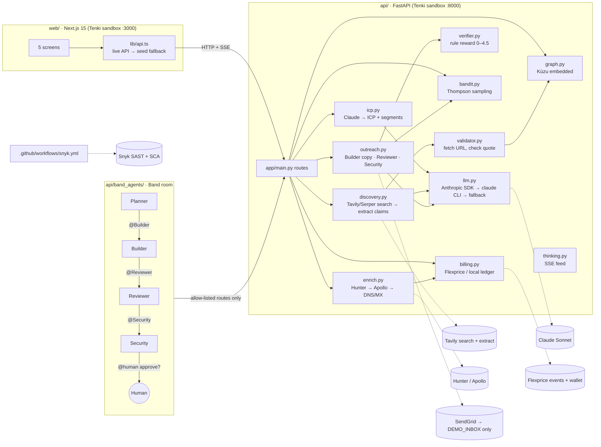

# Kindred — the AI GTM engine that only says what it can prove

[](https://github.com/MuhammadaliNazarov/kindred/actions/workflows/snyk.yml)

**Live demo:** https://kindred-sable-gamma.vercel.app (Vercel) · https://kindred--u6faat.us.sb.tenki.sh (Tenki)
**API:** https://kindred-api--u6faat.us.sb.tenki.sh/health · **Code:** https://github.com/MuhammadaliNazarov/kindred

Hackathon build for the "AI GTM Engine" spec (29 Oct 2026). Demo product: [Tenki](https://tenki.cloud) (agent sandboxes).

Clay finds leads. Kindred tells you **why now** and **who can introduce you**, and proves every claim:

- **Every prospect claim has a source URL and a verbatim quote.** A validator fetches the page and checks the quote is on it. If it is not, the claim is dropped before it reaches the graph (`GET /dropped` shows what was thrown away).
- **Nothing is sent without a human click.** Drafts sit in a HITL queue with a Reviewer verdict (claims vs. sources, verifier score) and a Security verdict (links, PII, tracking). Agents cannot reach the send route at all.
- **Warm paths from a knowledge graph.** Kùzu (embedded Cypher) holds companies, people, signals, sources and the founder's own past employers; a shortest-path query finds "you → ex-colleague → buyer".
- **Every lead is priced.** Enrichment, sends and graph queries are metered (Flexprice live, local ledger otherwise). When credits run out, enrichment stops with HTTP 402.
- **It learns.** A Thompson-sampling bandit shifts traffic between hook × CTA variants as replies come in, and the same rule-based verifier that gates copy in the HITL queue is the GRPO reward in `api/rl/`.

Spec-required docs: this README and [ARCHITECTURE.md](ARCHITECTURE.md) (system design). Demo script: [DEMO.md](DEMO.md). Original plan: [DESIGN.md](DESIGN.md).

## The 5 screens

| Screen | Route | What you see |
|---|---|---|
| Intake | `/intake` | Product URL + description (+ your past employers for warm paths). Claude builds the ICP. |
| ICP | `/icp` | Industries (NAICS), size band, personas, triggers; confidence bar and source chip on every field. 3 expansion segments with evidence: accept / adjust / dismiss. |
| Discovery + graph | `/discovery` | Grid of accounts and buyers: fit 0–60 + intent 0–40 = score 0–100, tier A/B/C, signal, source chip. Right pane: graph around the selected lead, warm path, and the Cypher that found it. Agent Thinking feed (SSE). |
| Outreach queue (HITL) | `/outreach` | Per lead: 3 touches (email, email, LinkedIn) built from one cited signal. Reviewer + Security verdicts inline, verifier checklist, bandit arm. Approve / Edit / Reject. |
| Pipeline | `/pipeline` | Kanban Matched → Contacted → Replied → Meeting → Closed. Every card shows AI or rep. Funnel by industry/tier, A/B by variant, bandit traffic shares. |

## Architecture



Everything in `api/app` runs **live when its key is set and falls back to deterministic demo data when it is not**, so the demo never breaks. `GET /health` reports the mode of every integration.

## Setup

Prerequisites: Node 20+, Python 3.12+, [uv](https://docs.astral.sh/uv/).

### API (`api/`)

```bash
cd api
cp .env.example .env          # fill whatever keys you have; everything else falls back
uv sync
uv run uvicorn app.main:app --reload --port 8000
curl localhost:8000/health    # shows live vs fallback per integration
```

On boot the server rebuilds `data/graph.kuzu` and loads the Tenki demo seed (fictional companies, `example.com` sources, `verified:false`, labelled "sample" in the UI). `POST /reset` reseeds everything (run it before recording).

| Variable | Required | What it does |
|---|---|---|
| `ANTHROPIC_API_KEY`, `ANTHROPIC_MODEL` | no | Claude via the Anthropic SDK (default model `claude-sonnet-5-5`). |
| `CLAUDE_CODE_OAUTH_TOKEN`, `CLAUDE_CLI_MODEL`, `CLAUDE_CLI_TIMEOUT` | no | With no API key, `app/llm.py` shells out to the `claude` CLI (your Claude Code login or a `claude setup-token` token). Personal use only. |
| `LLM_PROVIDER` | no | Force `anthropic`, `claude-cli` or `fallback`. |
| `TAVILY_API_KEY`, `TAVILY_KEYLESS` | no | Tavily search + extract. Keyless mode is **on by default** (rate-limited); `TAVILY_KEYLESS=0` turns it off. |
| `SERPER_API_KEY` | no | Second search provider after Tavily. |
| `HUNTER_API_KEY`, `APOLLO_API_KEY` | no | Enrichment waterfall. Without both, the free DNS/MX tier runs. `ENRICH_SEED=1` uses fabricated seed enrichment (never default). |
| `SENDGRID_API_KEY`, `SENDGRID_FROM`, `DEMO_INBOX`, `DEMO_INBOX_DOMAINS` | no | Real sends go **only** to `DEMO_INBOX`, which must be on one of `DEMO_INBOX_DOMAINS`. Otherwise sends are simulated. |
| `FLEXPRICE_API_KEY`, `FLEXPRICE_CUSTOMER_ID`, `FLEXPRICE_BASE_URL` | no | Flexprice metering + wallet. Otherwise `data/ledger.json`. |
| `DEMO_CREDITS` | no | Starting balance of the local wallet (default 400; set `3` to show the block on camera). |
| `DEMO_KEY` | no | When set, mutating/costly routes require header `X-Demo-Key` (stops casual scanning; not real auth). |
| `CORS_ORIGIN`, `CORS_ORIGIN_REGEX` | no | Allowed web origins (`deploy.sh` sets the Tenki preview regex). |

### Web (`web/`)

```bash
cd web
npm ci
NEXT_PUBLIC_API_URL=http://localhost:8000 npm run dev    # http://localhost:3000
```

| Variable | What it does |
|---|---|
| `NEXT_PUBLIC_API_URL` | API base URL. Unset = the UI runs entirely on the in-memory seed in `src/lib/seed.ts` (every call in `src/lib/api.ts` has a local fallback, so the UI never blanks). |
| `NEXT_PUBLIC_DEMO_KEY` | Sent as `X-Demo-Key`; must match the API's `DEMO_KEY` if set. |

Scripts: `npm run dev` · `npm run build` · `npm run start` · `npm run lint`.

### Band agents (`api/band_agents/`)

```bash
cd api/band_agents
cp .env.example .env     # 4 × (AGENT_ID, API_KEY) from app.band.ai → Agents → New remote agent
uv sync
./run_all.sh             # = uv run python agents.py all
./run_all.sh --dry-run   # no keys: scripted handoffs against localhost:8000 or an in-process stub
```

Create remote agents named exactly `Planner`, `Builder`, `Reviewer`, `Security`, add them and yourself to a room `kindred-demo`, then paste: `@Planner Find 10 Tier-A buyers for Tenki and draft outreach`.

| Variable | What it does |
|---|---|
| `PLANNER_AGENT_ID`/`_API_KEY` … `SECURITY_AGENT_ID`/`_API_KEY` | One Band remote agent per role. |
| `BAND_LLM` | `claude_sdk` (default when `ANTHROPIC_API_KEY` is empty: Claude Agent SDK → `claude` CLI, subscription) or `anthropic` (API key). |
| `CLAUDE_SDK_MODEL` / `CLAUDE_MODEL` | Model per backend (`sonnet` / `claude-sonnet-5-5`). |
| `PRICE_IN`, `PRICE_OUT` | $/1M tokens for the cost line each agent posts. |
| `KINDRED_API` | Backend URL (default `http://localhost:8000`). |

Full details: [api/band_agents/README.md](api/band_agents/README.md).

### Learning loop (`api/rl/`)

```bash
cd api
uv run python rl/bandit_sim.py --sends 300 --seed 0   # offline Thompson-sampling run, prints arm shares
uv run python rl/grpo_outreach.py --check              # proves the verifier reward ranks good copy above bad
```

GRPO training (`--model Qwen/Qwen2.5-0.5B-Instruct --steps 200`) needs one GPU and `trl`/`peft`; **post-hackathon**. See [api/rl/README.md](api/rl/README.md).

## Sponsor integrations: exactly how each is used

| Sponsor | Where | What it does in the product |
|---|---|---|
| **Band** | `api/band_agents/agents.py` | Four `band-sdk` remote agents (Planner, Builder, Reviewer, Security) in one room with the human. Each has an allow-list of API routes (`ALLOWED[role]`); `/touches/{id}/send` and anything schema-shaped are in `FORBIDDEN` for every agent. `approvetouches` only works when the **latest message from a non-agent participant** contains `approve` (`require_human_approval`), recorded by the adapter's `on_turn`, never asserted by the model. Each turn emits `Emit.USAGE` and posts a `usage · role: N in / M out · ≈$` line. Backend: `ClaudeSDKAdapter` (subscription) or `AnthropicAdapter` (API key). |
| **Flexprice** | `api/app/billing.py` | Three metered events: `lead_enriched` (5 credits), `outreach_sent` (1), `graph_query` (0.1). Live: `POST {base}/events` per event (`x-api-key`, `external_customer_id`) and `GET {base}/customers/wallets?lookup_key=…&include_real_time_balance=true` for the balance (5 s cache). `billing.check()` raises **HTTP 402** `out_of_credits` before enrichment or a send; the thinking feed shows "Enrichment paused — out of credits". The local ledger always runs too, so the gate holds even if the wallet lags. |
| **Snyk** | `.github/workflows/snyk.yml` | On every push/PR: Snyk Code (SAST, SARIF uploaded to GitHub code scanning), Snyk Open Source on `web/` (fails on high severity) and on `api/pyproject.toml`. Needs repo secret `SNYK_TOKEN`. |
| **Tenki** | `deploy.sh`, two sandboxes `kindred-web` (web) and `kindred-backend` | Both services run in Tenki sandboxes; the public demo is a Tenki preview URL. Tenki is also the demo *product* being sold: the seed intake, ICP and copy are about tenki.cloud. |
| **Tavily** | `api/app/discovery.py`, `api/app/validator.py`, `api/app/icp.py` | **Search** (`/search`, `exclude_domains` for aggregators, `include_domains` for ATS/news, `topic=news`, `time_range=month`) finds job posts, funding and launches that match the ICP, and 1–2 evidence sources per ICP field and expansion segment (≤20 searches, cached in `data/cache/`). **Extract** (`/extract`) is the validator's second opinion when a direct fetch fails or the page is JS-rendered. Works with `TAVILY_API_KEY` or in keyless mode; last good results per query are cached in `data/search_cache.json` and re-validated on every run. |
| **Claude** (Anthropic) | `api/app/llm.py` | ICP + expansion segments (`icp.py`), claim extraction from search results with verbatim quotes (`discovery.py`), 3-touch copy (`outreach.py`). JSON-only calls; every call has a deterministic fallback. |

Other services: **Hunter.io** (email-finder / domain-search + email-verifier with MX) → **Apollo** (`people/match`) → free **DNS/MX** tier via dnspython (`enrich.py`); **SendGrid** `mail/send` with click/open tracking disabled (`outreach.py`); **Serper** as a second search provider.

## Live vs fallback

`GET /health` → `modes` tells you which column you are in.

| Capability | Live when | Fallback when not | How to tell |
|---|---|---|---|
| Claude (ICP, extraction, copy) | `ANTHROPIC_API_KEY`, or the `claude` CLI on PATH / `CLAUDE_CODE_OAUTH_TOKEN` | Canned Tenki ICP + template copy (`fallback_icp`, `_fallback`) | `modes.llm` = `anthropic` / `claude-cli` / `fallback`; audit says `(claude)` or `(fallback)` |
| Web search | `TAVILY_API_KEY`, or Tavily keyless (default on), or `SERPER_API_KEY` | Seeded Tenki dataset (fictional companies, `example.com`, `verified:false`, UI label "sample") | `modes.search`; thinking feed names the provider per query |
| Quote validation | Always: direct fetch + Tavily Extract; SSRF-guarded (public IPs only, ≤2 MB, 3 redirects) | None. Unverifiable claims are **dropped**, listed at `GET /dropped` | Red "Dropped: …" lines in Agent Thinking |
| Enrichment | `HUNTER_API_KEY` → `APOLLO_API_KEY` | Free tier: live DNS A/AAAA + MX check, **no email claimed** (`email=null`, `provider="dns"`, pattern guess labelled as a guess). `ENRICH_SEED=1` = fabricated seed data, opt-in only | `modes.enrichment`; `enrichment.verification` text on the person |
| Email send | `SENDGRID_API_KEY` + `SENDGRID_FROM` + `DEMO_INBOX` on `DEMO_INBOX_DOMAINS` | Simulated: status becomes `sent`, nothing leaves the box | `modes.email`; audit detail says `SendGrid → inbox` or `simulated (…)` |
| Billing | `FLEXPRICE_API_KEY` + `FLEXPRICE_CUSTOMER_ID` | `data/ledger.json` starting at `DEMO_CREDITS`; same 402 gate | `modes.billing` = `flexprice` / `local_ledger` |
| Graph | Always live: Kùzu embedded, rebuilt from state on boot | — | `modes.graph` = `kuzu` |
| Band room | 4 agent IDs/keys + Band Cloud | `--dry-run`: same tool handlers and HITL gate, scripted handoffs, in-process API stub if the backend is down | Terminal shows `backend: LIVE` or `STUB` |
| Bandit | Always live: real rewards from stage moves / `POST /webhooks/reply` | `POST /bandit/simulate` runs **simulated** replies on a copy, flagged `simulated:true` | `GET /bandit` → `simulated` |
| LinkedIn touch | — | Always a copy-to-clipboard task (no unofficial API) | Audit: "LinkedIn task created" |
| Web UI | `NEXT_PUBLIC_API_URL` reachable | In-memory seed, every call (`src/lib/api.ts`) falls back per request | Rows labelled "sample"; thinking feed replays seed steps |

## Deploy (`deploy.sh`)

```bash
./deploy.sh        # web + api
./deploy.sh web    # or api
```

`deploy.sh` tars each service (excluding `node_modules`, `.next`, `.venv`, `data`, `.env`), base64-writes it into the Tenki sandbox with `tenki sandbox write`, then `tenki sandbox exec`:

- **web** (session `kindred-web`): `npm ci`, `NEXT_PUBLIC_API_URL=https://kindred-api--u6faat.us.sb.tenki.sh npm run build`, restart `next start -p 3000 -H 0.0.0.0` detached, curl `/intake`.
- **api** (session `kindred-backend`): `uv sync`, source `~/gtm/api/.env` in the sandbox (secrets live there, never in git), restart `uvicorn app.main:app --port 8000` with `CORS_ORIGIN_REGEX` for `*.us.sb.tenki.sh`, curl `/health`.

Needs the `tenki` CLI at `~/.local/bin/tenki` and the two sandbox sessions already created. Before recording: `curl -X POST https://kindred-api--u6faat.us.sb.tenki.sh/reset`.

## Rules we never break

1. Every prospect claim has a source URL and a quote that was found on that page.
2. Nothing is sent without a human clicking Approve (or typing `approve` in the Band room); agents cannot reach the send route.
3. Public data only. Demo mail goes to our own inbox, never to a prospect; the body carries a `[DEMO SEND …]` banner.

## Post-training and RL: every human decision trains the model

Kindred is a GTM agent that gets better from its own workflow: **the gate that checks every message is also the reward that trains the model.**

| Piece | What it is | Where |
|---|---|---|
| **Reward (RLVR)** | A rule-based verifier, max 5.5: company named, signal cited, question CTA, 30–90 words, every claim sourced, opens with congratulations, signed with name and role, with penalties for outcome guarantees and off-domain links. The same function gates the human approval queue **and** is the RL reward. | `api/app/verifier.py` |
| **Human feedback into reward rules** | A reviewer (Ali) asked for "congratulations" openers and a name and role sign-off. These became two new verifier checks. | `verifier.py`, `outreach.py` |
| **RL environment** | Gym/OpenEnv style: `POST /env/reset` gives a real lead plus its cited signal; `POST /env/step {draft}` returns the reward and per-check results. | `api/rl/outreach_env.py`, `api/app/rl_api.py` |
| **Preference dataset (DPO)** | Every human **edit** becomes *original = rejected, edit = chosen*, and every **reject** becomes a pair too; verifier score gaps add synthetic pairs, labelled as such. Download it with `GET /export/preferences`. | `api/app/rl_api.py` |
| **GRPO training** | TRL `GRPOTrainer`, SmolLM2-135M-Instruct + LoRA, 4 generations per prompt, reward = verifier score, on **Tenki CPU sandboxes**. | `api/rl/train_grpo_cpu.py` |
| **DPO training** | TRL `DPOTrainer` on the exported human and verifier pairs, also on Tenki. | `api/rl/train_dpo_cpu.py` |
| **Evals** | 30 held-out leads from companies never used in training; base vs trained on each check. | `api/rl/eval.py`, the Model · RL tab |
| **Harbor dataset** | 20 outreach tasks in Harbor format, with a per-check reward in `reward.json`. The oracle scored 2/2 at 1.0 in a Tenki sandbox. Wired to the harbor-cookbook `harbor-rl` recipe (Tinker). | `harbor/` |
| **Learned inference-time policy** | A Thompson-sampling bandit over message hooks and CTAs, with replies as the reward. | `api/app/bandit.py` |

### Results (30 Oct 2026, 30 held-out leads)

| Run | Avg reward | Cites signal | No banned claims | Length OK |
|---|---|---|---|---|
| Base SmolLM2-135M | 0.658 | 100% | 96.7% | 46.7% |
| **GRPO run 1** (20 steps, LR 2e-5, Tenki) | **0.675** | 100% | 96.7% | 50.0% |
| GRPO run 2 (60 steps, LR 2e-4, Tenki) | 0.683 | 90.0% ↓ | 86.7% ↓ | 60.0% |
| DPO (4 human + 19 verifier pairs, Tenki) | 0.675 | 100% | 93.3% | 50.0% |

**What we learned:**
- **Run 2 is reward hacking.** Pushed harder, the model raised its total score through length while getting sloppier on citations and claims. The per-check evals caught it, which is why we ship run 1 and keep the verifier as a hard gate.
- **DPO only learns what reviewers show it.** With 4 human pairs it improved length and style but not the no-guarantees rule. More reviews, especially rejects of overclaiming drafts, fix that.
- **Scale.** It's a 135M model, 20–60 steps, on CPUs. The loop is real; the gains are small and grow with reviews and a GPU.
